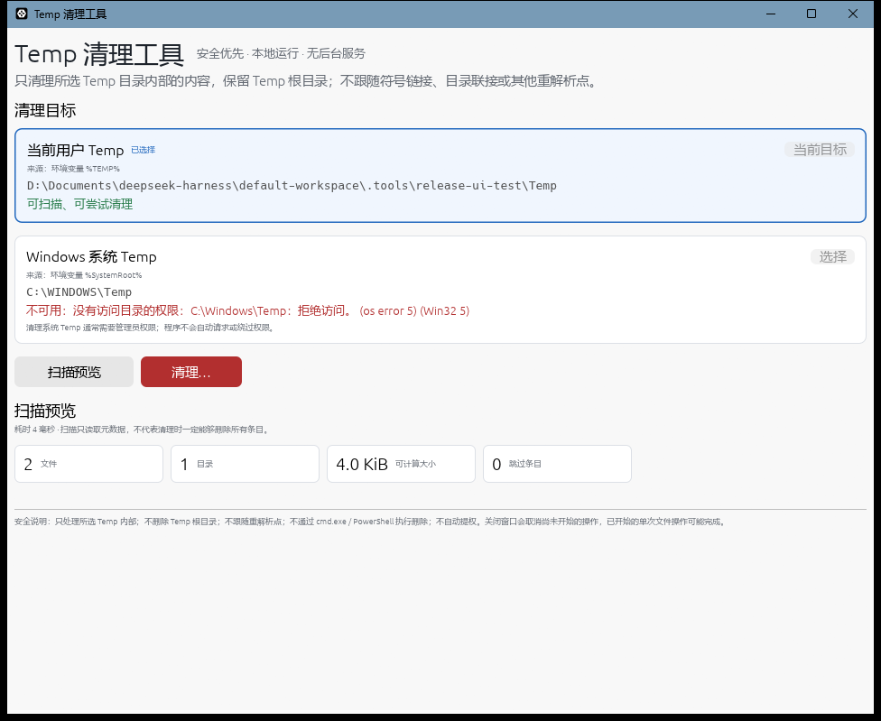
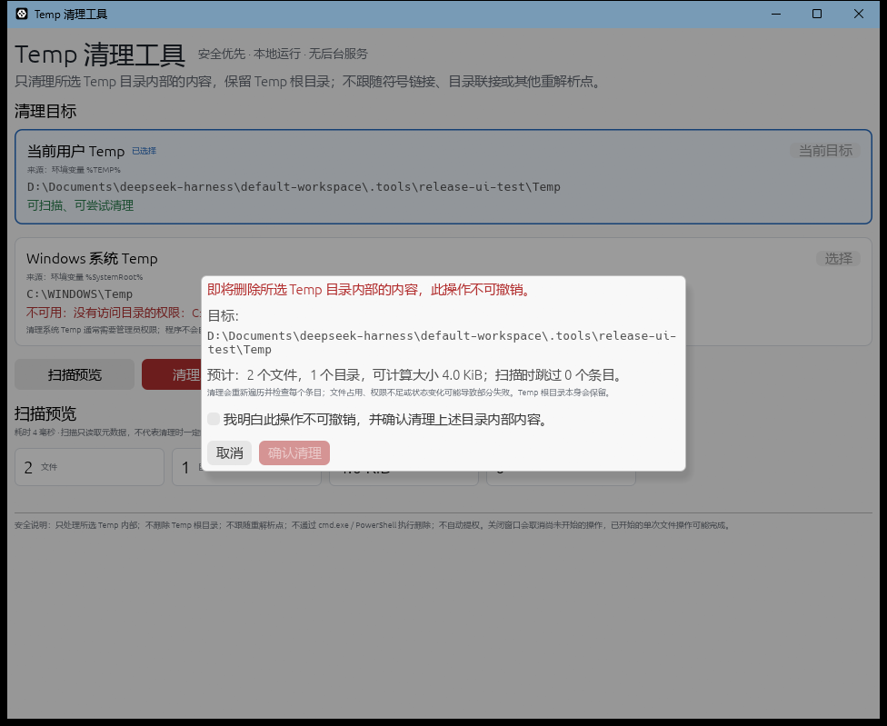
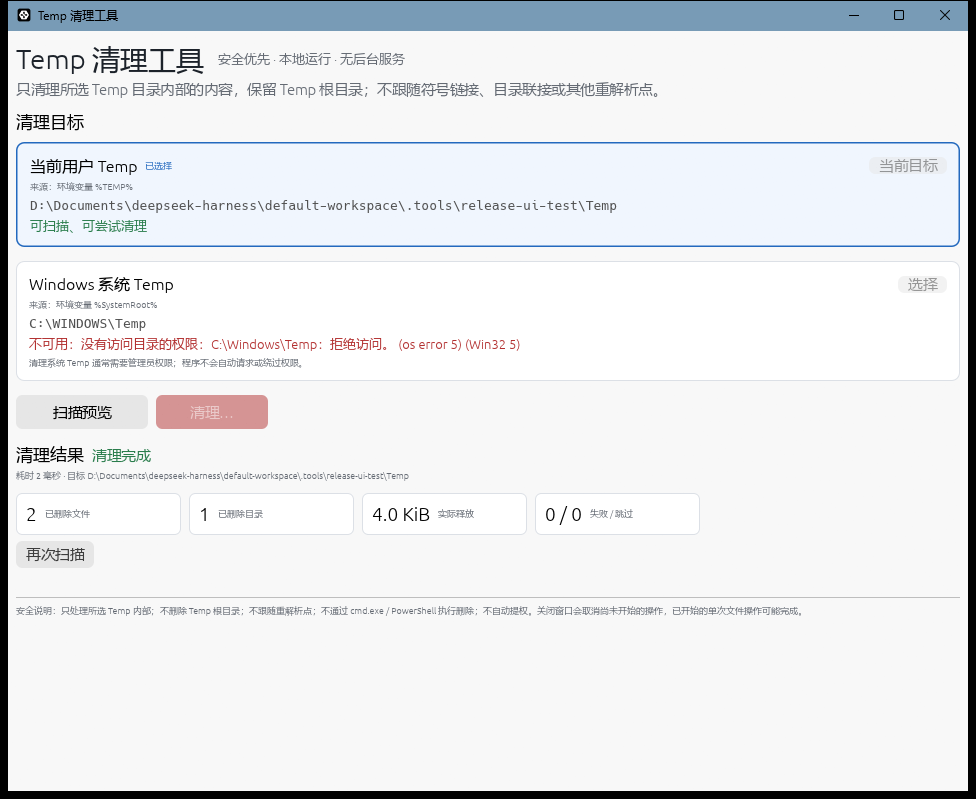

# TempCleaner 1.0.0

面向 Windows 10/11 x64 的轻量级临时目录清理工具。使用 Rust + egui/eframe 编写，不依赖 Electron、浏览器壳、后台服务或常驻进程。

程序只清理用户明确选择的以下两个目标之一，并始终保留 Temp 根目录本身：

- 当前用户 Temp：运行时解析 `%TEMP%`，缺失或为空时参考 `%TMP%`。
- Windows 系统 Temp：运行时解析 `%SystemRoot%\Temp`，`SystemRoot` 缺失时参考 `%windir%`。



## 1. 交付摘要

| 项目 | 实际结果 |
|---|---|
| 版本 | 1.0.0 |
| 语言 / UI | Rust Stable + egui/eframe 0.37（glow 后端、系统字体回退） |
| 目标平台 | Windows 10/11 x64；本次运行验证环境为 Windows 11 NT 10.0.26200 x64 |
| 核心依赖 | `eframe`、`windows-sys`；无网络、无数据库、无后台服务 |
| Release 可执行文件 | `target/release/temp-cleaner.exe`，5,699,584 字节 |
| SHA-256 | `c99dff392583f4cd02826a61e3356c68f97034b823d7e03a23695f4d6d90ed7b` |
| 构建验证 | `cargo fmt --check`、`cargo check`、`cargo test`、`cargo clippy -D warnings`、`cargo build --release` 均实际通过 |
| 自动化测试 | 27 个单元测试 + 7 个集成测试，共 34 个通过，0 失败 |
| GUI 验证 | Release 版本实际启动、自动扫描、二次确认、清理并显示结果 |
| 管理员权限 | 不请求、不自动提升；系统 Temp 可能因 ACL 不可访问 |
| 网络 / 遥测 | 无 |
| 第三方字体 | 不捆绑；通过 eframe `system_fonts` 使用系统字体显示中文 |

> 以上构建、测试、运行时数据和截图均来自本轮实际执行，不是模拟结果。Windows 10 实机、MSVC 工具链和系统 Temp 的实际清理未在本环境验证，详见“限制与未验证项”。

## 2. 功能

- 两种目标，界面同时显示名称、来源环境变量、规范化绝对路径和可用状态。
- 启动时只解析路径，默认自动执行**只读扫描**；不会自动删除。
- 扫描只读取目录项和元数据，不读取文件内容。
- 显示文件数、目录数、可计算总大小、跳过条目数及跳过原因。
- 清理前显示目标绝对路径、扫描统计、跳过数量和不可撤销提示。
- 必须勾选确认复选框并再次点击“确认清理”才会执行删除。
- 清理使用后台线程，不阻塞 UI；进度使用真实计数，不伪造百分比。
- 支持取消：不会启动新的删除/扫描；已经进入底层系统调用的单次操作可能完成。
- 结果区分：完成、无内容、部分成功、失败、已取消。
- 统计成功删除文件数、成功删除目录数、实际释放字节数、跳过数和失败数。
- 失败/跳过详情可展开查看（最多保留 240 条明细，计数保持完整）。
- 关闭窗口会取消尚未开始的任务，不留下后台清理服务。
- 不修改 ACL、不关闭安全软件、不结束进程、不清理回收站、不自动提权。





## 3. 目标与路径规则

### 3.1 当前用户 Temp

1. 读取 `TEMP`。
2. 仅当 `TEMP` 缺失或为空时，才读取 `TMP`。
3. 如果 `TEMP` 存在但无效，不会静默回退到 `TMP`；界面会明确显示错误。
4. 展开其中的 `%...%` 变量；如果仍有未解析变量，拒绝该路径。
5. 路径必须：
   - 是绝对路径；
   - 只有本地盘符前缀（拒绝 UNC、设备路径、相对路径、`..`）；
   - 包含名为 `Temp` 的路径组件（允许 `...\Local\Temp\session-1` 这类会话子目录，也支持 `%TEMP%` 本身名为 `Temp`）；
   - 不是磁盘根目录、用户主目录、Windows 目录、Program Files、ProgramData、Users 等受保护位置，也不是这些位置的祖先；
   - 每一级已存在祖先和目录自身都不是符号链接、目录联接或其他重解析点；
   - 实际是目录且可读取。
6. 路径会通过句柄获取规范化绝对路径和卷序列号 + 文件索引。

如果 `%TEMP%` 被错误设置为与 Temp 无关的目录（例如 `D:\scratch`），目标会被标记为不可用，程序不会删除该目录。

### 3.2 Windows 系统 Temp

1. 读取 `SystemRoot`，缺失或为空时参考 `windir`。
2. 拼接 `Temp`，解析为绝对路径。
3. 除同样执行上述路径、重解析点和受保护位置检查外，最终目录名必须为 `Temp`。
4. 该目录通常需要管理员权限。程序**不会**自动请求管理员权限；如果没有读权限，界面显示“不可用”；如果可读但没有删除权限，界面显示权限受限，清理可能部分失败。

Windows 目录受到额外限制：只有精确的系统目标 `%SystemRoot%\Temp` 可以清理；例如 `%TEMP%` 被错误设置为 `C:\Windows\System32\Temp` 时会被拒绝。

### 3.3 关于 “C 盘 Temp”

本项目将“Windows 系统 Temp”严格解释为 `%SystemRoot%\Temp`（通常是 `C:\Windows\Temp`），不会因此清理整个 `C:\`。本项目不提供单独的 `C:\Temp` 目标；只有当它确实来自用户自己的 `%TEMP%` 时，才可能作为目标 A 出现。

### 3.4 重复目标

两个候选目录会通过句柄身份（卷序列号 + 文件索引）和规范化路径比较。如果指向同一个目录，系统 Temp 会被禁用并明确说明，避免重复清理。

## 4. 使用方法

1. 启动 `temp-cleaner.exe`。程序默认选中可用的当前用户 Temp，并自动执行一次只读扫描。
2. 如需切换，点击“Windows 系统 Temp”的“选择”按钮；不可访问或重复的目标不可选。
3. 点击“扫描预览”刷新统计。
4. 点击“清理…”，核对目标绝对路径和预计内容，勾选确认复选框，再点击“确认清理”。
5. 查看清理结果和问题详情。若需要继续清理，先重新扫描。

程序不会在启动时删除任何文件。关闭窗口不会保留常驻后台任务。

## 5. 安全设计

完整实现位于 `src/paths.rs`、`src/scan.rs`、`src/cleanup.rs`、`src/winfs.rs`。

### 5.1 删除方式

- 不使用 `cmd.exe`、PowerShell、批处理、`del`、`rd` 或宽泛通配符执行删除。
- 使用 Rust 文件系统 API 枚举；使用 Win32 `SetFileInformationByHandle(FILE_DISPOSITION_INFO)` 对已打开句柄标记删除并在关闭后完成。
- 根目录本身永远不会加入删除队列。
- 单个条目失败不会中止其他条目的处理，错误会被计数并保留原因。

### 5.2 重解析点与目录联接

- 通过 `symlink_metadata` 和 `FILE_ATTRIBUTE_REPARSE_POINT` 检查每个条目。
- 打开条目时使用 `FILE_FLAG_OPEN_REPARSE_POINT`，打开链接本身而不是其目标。
- 发现符号链接、目录联接、挂载点或其他重解析点时跳过，并记录原因；不会对其目标递归删除。
- 对根目录及每一级已存在祖先都执行重解析点检查，而不是只看 `canonicalize` 后的结果。

### 5.3 边界与 TOCTOU 防护

- 清理阶段重新遍历目录，不把扫描结果直接当作删除清单。
- 每个待删除条目重新打开句柄，验证：
  - 句柄对应的确实是普通文件/目录；
  - 它不是重解析点；
  - `GetFinalPathNameByHandleW` 返回的最终路径按路径组件严格位于所选根目录内；
  - 删除目录时仅删除已经为空的目录。
- 使用 `Path::strip_prefix` 的组件级边界比较，不使用字符串前缀比较。
- 清理期间以不共享删除权限的方式持有根目录句柄，避免根目录被改名/替换；根目录身份还会与扫描前保存的文件索引比较。
- 如果条目在扫描后被替换为链接、目录或已消失，会跳过并记录，而不是误报成功。

### 5.4 权限与错误

- 不自动提权、不修改 ACL、不强制解锁文件。
- 文件占用、访问拒绝、只读属性、目录非空、路径过长、磁盘资源不足等情况会分类并显示。
- 扫描和清理均使用后台线程，UI 只接收计数和最终报告。
- 取消是协作式的：不会启动后续操作，但不能保证中断已经进入系统调用的单次文件操作。

### 5.5 不静默吞错

项目没有使用 `2>nul` 式静默忽略。单个条目的错误会汇总为：
- 跳过（例如重解析点、扫描后消失、越界）；
- 失败（例如拒绝访问、占用、只读、目录非空）。

明细最多保留 240 条，避免超大目录造成内存和 UI 卡顿，但跳过/失败总数保持精确。

## 6. 工程结构

```text
TempCleaner/
├── Cargo.toml
├── Cargo.lock
├── rust-toolchain.toml
├── README.md
├── LICENSE
├── scripts/
│   ├── verify.ps1
│   └── package.ps1
├── src/
│   ├── main.rs          # 程序入口、原生窗口、致命错误对话框
│   ├── lib.rs           # 库入口
│   ├── app.rs           # egui 界面、目标选择、确认、结果展示
│   ├── worker.rs        # 后台扫描/清理线程与消息通道
│   ├── paths.rs         # 环境变量解析、目标白名单、路径安全检查
│   ├── scan.rs          # 只读扫描与统计
│   ├── cleanup.rs       # 重新遍历、删除、失败统计、取消
│   ├── winfs.rs         # 最小范围的 Win32 句柄/删除封装
│   ├── models.rs        # 统计、状态、问题模型
│   └── error.rs         # 路径错误和 Win32 错误分类
└── tests/
    └── temp_cleaner_integration.rs
```

UI 与扫描/清理解耦；删除入口只能接收经过校验的 `TempRoot`。UI 不提供任意路径输入框。

## 7. 从源码构建

### 7.1 环境要求

- Windows 10/11 x64；
- Rust Stable（项目要求 Rust 1.95+，本次使用 1.99.1）；
- 推荐 MSVC 工具链（rustup 的 `stable-x86_64-pc-windows-msvc` 加 Visual Studio Build Tools C++ 组件）；
- PowerShell 7（可选，用于脚本）。

### 7.2 标准构建命令

```powershell
rustup default stable-x86_64-pc-windows-msvc
rustup component add rustfmt clippy
cargo fmt --all -- --check
cargo check --all-targets --locked
cargo test --all-targets --locked
cargo clippy --all-targets --all-features --locked -- -D warnings
cargo build --release --locked
```

产物：

```text
target\release\temp-cleaner.exe
```

### 7.3 本环境实际使用的 GNU 工具链

本次环境没有可用的 MSVC C++ 工具链，实际使用：

```text
rustc 1.99.1 (x86_64-pc-windows-gnu)
cargo 1.99.1
Windows 11 26200 x64
```

GNU 目标需要可用的 MinGW-w64 binutils（`dlltool.exe` 等）。本次使用便携的 w64devkit，并将 Rust 自带的 GNU 运行库加入链接搜索路径后构建。普通用户若使用 MSVC 工具链，不需要这些额外步骤。

GNU 构建也成功；Release 可执行文件的导入表中没有 `libgcc_s_*.dll` 或 `libwinpthread-1.dll`，运行时只需要 Windows 系统 DLL。

### 7.4 一键验证与打包

```powershell
pwsh -File scripts\verify.ps1
pwsh -File scripts\package.ps1
```

`package.ps1` 会生成：

```text
artifacts\TempCleaner-1.0.0-win-x64\
artifacts\TempCleaner-1.0.0-win-x64.zip
```

包内包含 exe、README、LICENSE、界面截图和 SHA256SUMS。

## 8. 实际验证记录

执行日期：2026-10-29（Asia/Hong_Kong）。

| 命令 | 结果 |
|---|---|
| `cargo fmt --all -- --check` | 通过，无格式差异 |
| `cargo check --all-targets --locked` | 通过 |
| `cargo test --all-targets --locked` | 34 通过，0 失败 |
| `cargo clippy --all-targets --all-features --locked -- -D warnings` | 通过 |
| `cargo build --release --locked` | 通过 |
| 直接启动 Release GUI | 通过；窗口子系统为 Windows GUI，无控制台窗口 |
| GUI 自动扫描、确认、清理、结果显示 | 通过；测试目录清理后为空，Temp 根目录保留 |

自动化测试覆盖：

- 用户 Temp / 系统 Temp 环境变量解析；
- `TEMP` 缺失时回退 `TMP`、`TEMP` 无效时不回退；
- 缺失变量、相对路径、`..`、文件冒充目录、受保护位置、Windows 目录内仅允许精确系统 Temp；
- 多层目录扫描、空目录、大小统计、Unicode/空格文件名；
- 普通删除、嵌套目录递归清理、根目录保留；
- 占用文件报告失败、只读文件结果与文件系统状态一致；
- 符号链接/目录联接不跟随，外部目标不被删除；
- 扫描后文件被替换成目录联接的 TOCTOU 场景；
- `TempEvil` 这类同前缀兄弟目录不会被当作目标内部；
- 启动前取消、扫描中途取消、清理中途取消；
- 重复目标检测、路径边界组件比较。

测试只会操作系统临时目录下自己创建的唯一子目录，不会把真实用户 Temp 或 `C:\Windows\Temp` 作为自动化删除对象。测试中的目录联接使用 `cmd /C mklink /J` 仅作为测试夹具创建手段；产品删除逻辑完全不调用外部命令。

## 9. 权限说明

- 可执行文件未嵌入 `requestedExecutionLevel`，默认按 `asInvoker` 启动。
- 管理员权限不是启动前提；但 Windows 系统 Temp 通常需要更高权限。
- 普通用户可能可以读取系统 Temp 但不能删除其中条目；程序会显示权限受限或逐项失败。
- 程序不会尝试通过 UAC、计划任务、服务或提权助手绕过 ACL。

## 10. 限制与未验证项

1. **Windows 10 未实机运行**：本次只在 Windows 11（NT 10.0.26200）x64 上构建和运行；使用的 API 均面向 Windows 10/11。
2. **系统 Temp 实际清理未执行**：当前构建/测试进程为低完整性、非提升进程，访问 `C:\Windows\Temp` 被拒绝；界面正确显示“不可用/拒绝访问”，但没有执行系统 Temp 删除验证。
3. **MSVC 构建未验证**：本机没有 MSVC C++ 工具链，仅实际验证 GNU 工具链。README 的标准 MSVC 命令是推荐路径，但本轮未执行。
4. **依赖 OpenGL**：eframe 使用 glow/OpenGL 后端；在图形驱动异常或远程环境没有可用 OpenGL 时，可能无法创建窗口。该情况会显示启动错误对话框，而不是静默失败。
5. **无安装包、无代码签名、无自动更新**：交付物是便携 exe；未生成 MSI/MSIX，也未签名。
6. **只读文件通常不会被强制删除**：只读属性可能导致失败并显示原因；程序不主动清除只读属性。
7. **取消不是硬中断**：已提交给文件系统的单次删除可能完成；程序会如实报告取消和已发生的删除。
8. **不提供自定义任意目录**：界面只有两个预定义目标；没有“选择任意文件夹”功能，也没有单独配置 `C:\Temp` 的功能。
9. **无文件年龄/类型过滤**：除安全跳过项外，Temp 内所有普通文件和普通子目录都属于清理候选。需要保留的文件不要放在 Temp。
10. **硬链接语义**：Windows 硬链接是普通文件；删除 Temp 中的硬链接只会删除该目录项，不会递归跟随到其他路径，但链接计数会减少。
11. **极端路径/文件系统**：超长路径、损坏文件系统、过滤驱动或网络重定向可能返回额外错误；这些错误会被分类报告，但程序不保证清理成功。
12. **系统字体回退**：中文显示依赖系统的 DirectWrite 字体回退。若系统缺少可显示中文的字体，界面可能显示替代字形；本项目不捆绑字体。
